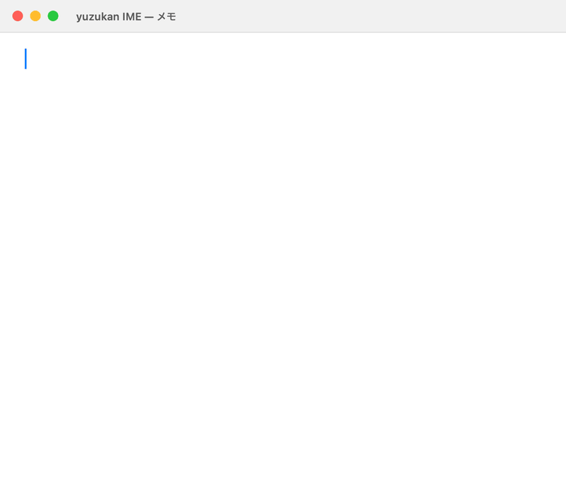

# yuzukan IME

[karukan](https://github.com/togatoga/karukan) IMEを元にしたローカルLLMでかな漢字変換するmacOS専用日本語IMEです。精度の高いライブ変換を使えます。



## 主な最適化

- CPU推論に絞り、不要なGPU初期化と重みの複製を削減
- 2つのモデルでトークナイザーを共有
- 辞書をメモリマップで読み込み、索引を圧縮
- 絵文字などの変換表をビルド時に生成
- 候補ウィンドウと通信の処理を軽量化

メモリの測定結果は[メモリと最適化](docs/memory.md)を参照してください。

## 導入

macOS13以降が対象です。

### pkgでインストールする

Apple SiliconのMac向けです。

1. [Releases](https://github.com/otofu1024/yuzukan/releases)からpkgをダウンロードして開きます。
2. 初回はmacOSが開くのを止めるので、「システム設定」の「プライバシーとセキュリティ」で「このまま開く」を選びます。
3. 一度ログアウトし、「システム設定」の「キーボード」→「入力ソース」で**yuzukan**を追加します。

### ソースから導入する

Xcode Command Line Tools、Rust、CMakeが必要です。

```sh
git clone https://github.com/otofu1024/yuzukan.git
cd yuzukan/yuzukan-im/macos
make install
```

モデルと辞書は導入時に自動ダウンロードされます。初回は上の手順3で入力ソースを追加してください。

## ドキュメント

- [設定](docs/configuration.md)
- [キー操作](docs/key-bindings.md)
- [デザイン](docs/design.md)
- [メモリと最適化](docs/memory.md)
- [macOS版の詳細](yuzukan-im/macos/README.md)

## ライセンス

コードは[MIT](LICENSE-MIT)または[Apache-2.0](LICENSE-APACHE)。
モデル・辞書データは各配布元のライセンスに従います。[第三者ライセンス](THIRD_PARTY_LICENSES)も参照してください。
