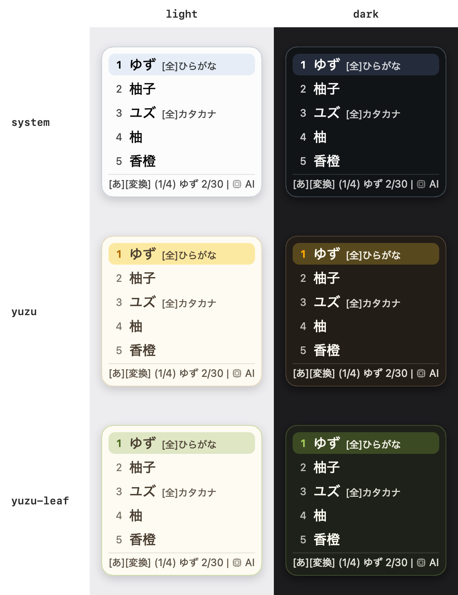

# デザイン

macOS 版の候補ウィンドウの配色とレイアウトをまとめたページです。配色の定義は [CandidateTheme.swift](../yuzukan-im/macos/Sources/YuzukanIME/CandidateTheme.swift)、レイアウトと描画は [CandidateWindowController.swift](../yuzukan-im/macos/Sources/YuzukanIME/CandidateWindowController.swift) にあります。

## テーマ



`config.toml` の `[display] theme` で切り替えます。設定変更後は `killall YuzukanIME` で再起動すると反映されます。

```toml
[display]
theme = "yuzu"                  # system（既定） / yuzu / yuzu-light / yuzu-dark / yuzu-leaf
```

| 値 | 外観 | 内容 | 別名 |
|---|---|---|---|
| `system` | ライト / ダーク自動 | 既定。ニュートラルなモノクローム配色 | `monochrome` |
| `yuzu` | ライト / ダーク自動 | ゆずイエローで選択行を示す、ゆずカラーの基本テーマ | |
| `yuzu-light` | 常にライト | `yuzu` のライト配色に固定 | `yuzu_light` |
| `yuzu-dark` | 常にダーク | `yuzu` のダーク配色に固定 | `yuzu_dark` |
| `yuzu-leaf` | ライト / ダーク自動 | ゆずリーフで選択行を示す緑基調 | `yuzu_leaf`、`yuzu-green`、`yuzu_green` |

> [!WARNING]
> 一覧にない値を書くと `config.toml` 全体が読み込めず、テーマ以外の設定もすべて既定値になります。原因はログ（`~/Library/Logs/YuzukanIME/yuzukan-ime.log`）に出ます。

## 方針

- 既定は `system` です。ゆずカラーは選んで使うバリエーションです。
- 選択行は背景の塗りだけで示します。選択行に枠線は付けません。
- フッターは文字とアイコンを同じ1色にします。アイコンだけに強調色を使いません。
- フッターの候補ソースは絵文字ではなく、単色の SF Symbols で表示します。
- テーマは見ただけで違いが分かるものに限ります。

## ゆずカラー

| 名前 | 色 | 由来 | 使いどころ |
|---|---|---|---|
| ゆずイエロー（Yuzu Yellow） | `#F9D030` | ゆずの果皮 | `yuzu` の選択行の背景 |
| ゆずリーフ（Yuzu Green） | `#84A93E` | ゆずの葉や未熟な青ゆず | `yuzu-leaf` の選択行の背景と、ライトの枠 |
| クリームホワイト（Cream White） | `#FDFBF2` | ゆずの果肉や和紙 | ライトの背景、ダークの文字 |
| チャコールブラウン（Charcoal Brown） | `#4A3E31` | ゆずの枝や土 | ライトの文字、`yuzu` ダークの枠 |
| ソフトアンバー（Soft Amber） | `#FFAA00` | 完熟したゆずや柚子茶 | `yuzu` ダークの選択中の番号 |

## 配色

括弧内の割合は不透明度です。

### ゆずカラー

| 要素 | `yuzu` ライト | `yuzu` ダーク | `yuzu-leaf` ライト | `yuzu-leaf` ダーク |
|---|---|---|---|---|
| 背景 | `#FDFBF2`（98%） | `#241E18`（98%） | `#FDFBF2`（98%） | `#1E2219`（98%） |
| 枠 | `#E3D9BD` | `#4A3E31` | `#84A93E`（40%） | `#3D4A2B` |
| 選択行の背景 | `#F9D030`（42%） | `#F9D030`（24%） | `#84A93E`（26%） | `#84A93E`（30%） |
| 候補の文字 | `#4A3E31` | `#FDFBF2` | `#4A3E31` | `#FDFBF2` |
| 選択中の番号 | `#B36B00` | `#FFAA00` | `#4D6A1F` | `#A4C95A` |

文字の濃淡は、ライトでは `#4A3E31`、ダークでは `#FDFBF2` の不透明度で付けます。

| 要素 | ライト | ダーク |
|---|---|---|
| 説明 | 65% | 62% |
| 説明（選択中） | 78% | 75% |
| 番号 | 50% | 48% |
| フッター | 68% | 66% |
| 区切り線 | 14% | 14% |

### system

| 要素 | ライト | ダーク |
|---|---|---|
| 背景 | 白（明度 98.5%、不透明度 98%） | `#121417`（98%） |
| 枠 | `#CCD1D9` | `#3D454D` |
| 選択行の背景 | `#E6EDF7` | `#242B3B` |
| 候補の文字・選択中の番号 | `labelColor` | `labelColor` |
| 説明・番号・フッター | `secondaryLabelColor` | `secondaryLabelColor` |
| 区切り線 | `separatorColor` | `separatorColor` |

`labelColor` などは macOS のシステムカラーです。

## レイアウト

### ウィンドウ

| 項目 | 値 |
|---|---|
| 角丸 | 14 pt |
| 枠の太さ | 1 pt |
| 内側の余白 | 8 pt |
| 行の間隔 | 3 pt |
| 最小幅 | 160 pt |

ウィンドウは入力中のアプリからフォーカスを奪わず、マウス操作も受け付けません。

### 候補の行

| 項目 | 値 |
|---|---|
| 角丸 | 8 pt |
| 内側の余白 | 上下 3 pt、左 6 pt、右 10 pt |
| 番号の欄 | 幅 14 pt、高さ 21 pt |
| 番号と候補の間隔 | 6 pt |

| 文字 | サイズ |
|---|---|
| 候補 | 18 pt |
| 説明 | 13 pt |
| 番号 | 13 pt（選択中はセミボールド） |
| フッター | 13 pt |

### 上段の「カタカナ / ひらがな」パネル

変換の先頭候補で `↑` を押すと、入力行の上に別のパネルが開きます。番号は付かず、行の左右の余白は 10 pt、高さは 27 pt 以上です。配色は候補ウィンドウと同じです。

### 表示位置

- 候補ウィンドウは入力行の下に出ます。下に収まらないときは上に出ます。
- 上段パネルは入力行の上に、4 pt 空けて出ます。画面に収まらないときは位置を調整します。

### 入力中の下線

入力中の文字列には下線を引きます。注目している部分は太線にします。

## フッターのアイコン

| 表示 | SF Symbols |
|---|---|
| 学習 | `clock.arrow.circlepath` |
| ユーザー | `person.crop.circle` |
| AI | `cpu` |
| 辞書 | `book.closed` |
| 変換 | `arrow.triangle.2.circlepath` |
| 日付 | `calendar` |
| 絵文字入力 | `face.smiling` |
| 変換範囲（[詳細表示](configuration.md#詳細表示verbose)） | `scope` |

## テーマを追加・変更するとき

色を変えるだけなら `CandidateTheme.swift` の `CandidatePalette` を編集します。テーマを増やすときは、次の場所をそろえて直します。

- `yuzukan-im/core/src/config/settings.rs` の `ColorTheme`
- `yuzukan-im/macos/Sources/YuzukanIME/CandidateTheme.swift` の `CandidateTheme`
- `yuzukan-im/core/config/default.toml` の説明コメント
- このページと [設定](configuration.md#カラーテーマtheme)
